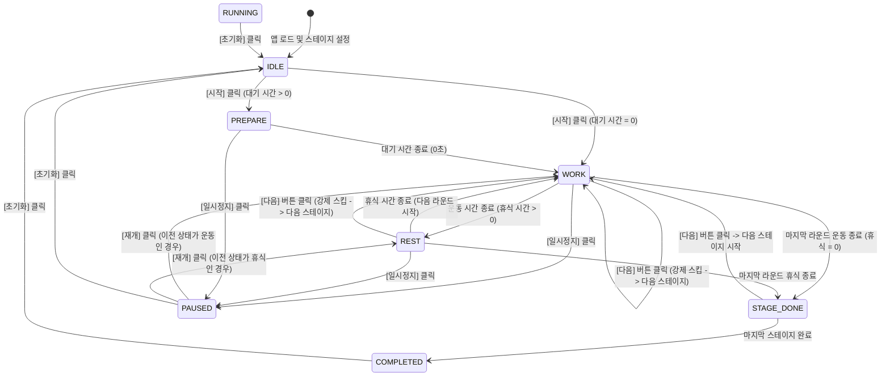
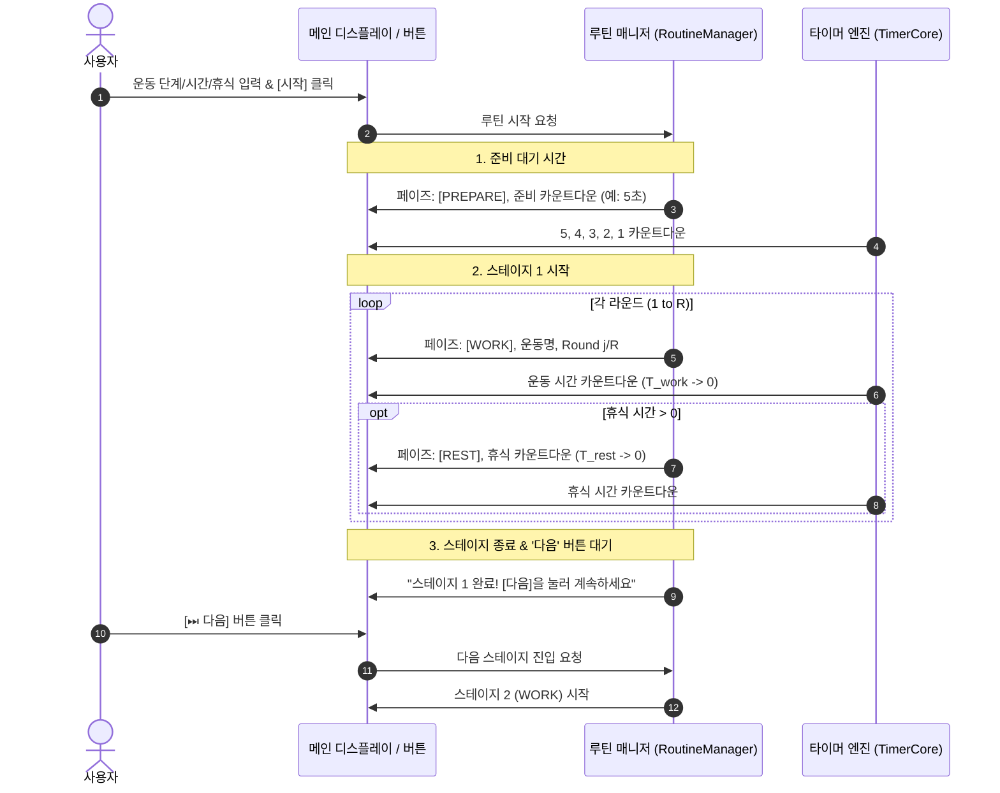

# 📋 운동 계획 웹 애플리케이션 프로젝트 기획 및 기능명세서 (v2.0)

---

## 1. 프로젝트 개요 (Project Overview)

- **프로젝트 명**: 인터벌 운동 루틴 타이머 (Workout Routine Timer Web App)
- **목적**: 사용자가 원하는 운동 단계(스테이지), 운동 시간, 휴식 시간, 라운드를 자유롭게 구성하고, 시작 전 준비 대기 시간 및 '다음' 버튼 제어를 통해 주도적으로 운동을 진행할 수 있는 고가시성 인터벌 타이머 제공
- **핵심 가치**:
  - **직관성**: 멀리서도 상태(준비/운동/휴식)를 즉각 인지할 수 있는 대형 타이머 및 시각적 색상 분기
  - **제어성**: 자동 진행뿐만 아니라 **'다음(Next Stage)' 버튼**을 통해 사용자 페이스에 맞춘 스테이지 전환 지원
  - **완전성**: 운동과 휴식(Rest), 시작 전 대기(Ready) 시간이 완벽히 결합된 현실적인 워크아웃 루틴 제공

---

## 2. 기술 스택 및 아키텍처 (Tech Stack & Architecture)

| 구분 | 기술 / 라이브러리 | 선정 이유 |
| :--- | :--- | :--- |
| **Markup** | HTML5 (Semantic Elements) | 접근성 및 명확한 구조 (`header`, `main`, `section`, `form`) |
| **Styling** | Vanilla CSS3 (CSS Variables, Flexbox/Grid) | 외부 라이브러리 없이 운동/휴식 상태에 따른 배경/테마 트랜지션, 대형 타이포그래피 |
| **Logic** | Vanilla JavaScript (ES6+) | 가볍고 정밀한 타이머 엔진, 상태 머신 기반의 모듈화된 이벤트 제어 |
| **데이터 관리** | 순수 JS 객체 기반 인메모리 상태 관리 | 빠르고 안정적인 반응형 상태 갱신 |

---

## 3. UI/UX 레이아웃 구조 설계 (Layout Wireframe)

```
+-------------------------------------------------------------+
|                     🏃 WORKOUT TIMER                        |
+-------------------------------------------------------------+
| [메인 디스플레이] (상태 테마: 준비/운동/휴식/완료)               |
|                                                             |
|           [WORK] 또는 [REST] 또는 [READY] 배지               |
|                    스쿼트 (Squat)                           |
|                     Round 2 / 3                             |
|                                                             |
|                        00:35                                |
|                (초대형 카운트다운 타이머)                    |
|                                                             |
|           ➡️ Next: 휴식 (15초) / 푸시업 (30s x 3R)           |
+-------------------------------------------------------------+
| [컨트롤 버튼 패널]                                           |
|   [ ▶ 시작 / 재개 ]   [ ⏸ 일시정지 ]   [ ⏭ 다음 ]   [ 🔄 초기화 ] |
+-------------------------------------------------------------+
| [기본 설정: 루틴 시작 전 대기 시간]                         |
|   준비 대기 시간: [ 5 ] 초                                  |
+-------------------------------------------------------------+
| [스테이지 구성 패널]                                         |
|  [ + 운동 단계 추가 ]                                       |
|  ---------------------------------------------------------  |
|  Step 1: [ 플랭크 ] [운동 45초] [휴식 15초] [ 3R ] [ 🗑️ 삭제 ] |
|  Step 2: [ 스쿼트 ] [운동 30초] [휴식 10초] [ 3R ] [ 🗑️ 삭제 ] |
|  Step 3: [ 푸시업 ] [운동 30초] [휴식 15초] [ 3R ] [ 🗑️ 삭제 ] |
+-------------------------------------------------------------+
```

---

## 4. 상세 기능 명세서 (Functional Specifications)

### F-01. 스테이지 동적 구성 및 대기 시간 설정 (Stage & Ready Settings)
- **설명**: 사용자가 운동 루틴에 원하는 만큼 단계를 추가/편집/삭제하고 시작 전 대기 시간을 설정
- **입력 필드**:
  1. **준비 대기 시간** (`prepareSeconds`): 루틴 시작 전 호흡을 가다듬고 자세를 잡기 위한 시간 (기본값: 5초, 범위: 0~60초)
  2. **운동 이름** (`stageName`): 텍스트 (예: "플랭크", 기본값: "새 운동")
  3. **운동 시간(초)** (`workSeconds`): 양의 정수 (최소 1초 ~ 최대 3600초)
  4. **휴식 시간(초)** (`restSeconds`): 0 이상의 정수 (0초 입력 시 휴식 없이 연속 진행, 기본값: 10초)
  5. **라운드 수** (`totalRounds`): 양의 정수 (최소 1회 ~ 최대 99회)
- **세부 동작**:
  - `[+ 운동 단계 추가]` 버튼 클릭 시 목록 최하단에 새로운 입력 행이 동적으로 생성됨.
  - 각 행마다 `[삭제]` 버튼 제공 (최소 1개 행 유지).
  - 타이머 작동(`RUNNING`/`PAUSED`) 중에는 입력 필드 및 행 조작이 **비활성화(Disabled)**되어 안전성 유지.

---

### F-02. 타이머 엔진 및 시퀀스 실행 (Timer Sequence Engine)
- **실행 단계**:
  1. **[준비 단계 (PREPARE)]**:
     - `[시작]` 클릭 시, 설정된 대기 시간(예: 5초) 동안 카운트다운 진행.
     - 메인 디스플레이에 "준비! (Get Ready)" 및 첫 번째 운동 예고.
  2. **[운동 단계 (WORK)]**:
     - 준비 종료 즉시 1번 스테이지 1라운드의 `운동 시간` 카운트다운 시작.
     - 시각적으로 활기찬 테마(주황/빨강 계열 등)로 전환.
  3. **[휴식 단계 (REST)]**:
     - 운동 시간 0초 도달 시, 설정된 `휴식 시간`이 0보다 크면 즉시 휴식 카운트다운 시작.
     - 시각적으로 안정적인 테마(초록/청록 계열 등)로 전환.
  4. **[라운드 전환]**:
     - 휴식 시간이 0초에 도달하면 다음 라운드(`Round + 1`)의 운동 단계로 자동 전환.
  5. **[스테이지 완료 및 다음 전환]**:
     - 해당 스테이지의 모든 라운드가 끝나면, 사용자가 준비할 수 있도록 대기하거나 **'다음' 버튼** 클릭을 통해 다음 스테이지로 안전하게 진입.

---

### F-03. '다음(Next)' 버튼을 통한 스테이지 전환 제어
- **설명**: 사용자가 자신의 페이스에 맞춰 다음 스테이지로 넘어갈 수 있도록 컨트롤 패널에 **[⏭ 다음]** 버튼 제공
- **동작 방식**:
  1. **스테이지 완료 시**:
     - 한 스테이지의 모든 라운드가 종료되면 화면에 "스테이지 완료! 준비되면 '다음'을 누르세요" 안내와 함께 일시 대기 상태로 전환되며, `[다음]` 버튼을 누르면 다음 스테이지 1라운드로 전환 및 가동.
  2. **운동 진행 중 수동 스킵**:
     - 현재 운동 중이라도 사용자가 `[다음]` 버튼을 누르면, 현재 스테이지를 즉시 완료 처리하고 다음 스테이지로 직행 가능.
  3. **마지막 스테이지일 때**:
     - 마지막 스테이지 완료 후에는 `[다음]` 버튼이 비활성화되거나 루틴 완료(COMPLETED)로 마감.

---

### F-04. 메인 디스플레이 (Main Display)
- **가시성 최우선 구성**:
  1. **현재 페이즈 뱃지**: `READY(준비)`, `WORK(운동)`, `REST(휴식)` 상태 뱃지
  2. **현재 스테이지 이름**: 크고 선명한 헤드라인 (예: "버피 테스트")
  3. **현재 라운드 / 총 라운드 표시**: 예: `Round 2 / 3`
  4. **남은 시간 카운트다운**:
     - 중앙에 가장 큰 폰트로 `MM:SS` (또는 초 단위) 출력
     - 마지막 3초에는 비프음/시각적 펄스 애니메이션 지원
  5. **Next(다음 순서) 안내**:
     - 운동 중: `Next: 휴식 (15초)`
     - 휴식 중 (같은 스테이지 내): `Next: 플랭크 (Round 2/3)`
     - 스테이지 마지막 휴식 중: `Next: 스쿼트 (다음 스테이지)`
     - 전체 종료 직전: `Next: 루틴 완료! 🎉`

---

### F-05. 컨트롤 버튼 및 상태 머신 (Routine Controls & State Machine)
- **컨트롤 패널 4대 버튼**:
  1. **시작 / 재개 (`Start / Resume`)**:
     - 대기 상태: 대기 시간 카운트다운 후 루틴 가동
     - 일시정지 상태: 멈춘 시점의 시간에서 재개
  2. **일시정지 (`Pause`)**:
     - 현재 카운트다운을 즉시 멈추고 현 상태 유지
  3. **다음 (`Next Stage`)**:
     - 다음 스테이지로 즉각 전환 (스테이지 완료 후 전환 또는 진행 중 스킵)
  4. **초기화 (`Reset`)**:
     - 진행 중인 모든 시퀀스를 중단하고, 1번 스테이지 1라운드(대기 전 초기 상태)로 원상 복구

---

## 5. 상태 머신 다이어그램 (State Diagram)



---

## 6. 시퀀스 다이어그램 (Sequence Execution Flow)



---

## 7. 데이터 모델 (Data Schema)

```javascript
// 개별 스테이지 설정 데이터
interface StageConfig {
  id: string;              // 고유 ID (예: 'stage-1')
  name: string;            // 운동 이름 (예: "스쿼트")
  workSeconds: number;     // 운동 시간(초) (예: 30)
  restSeconds: number;     // 휴식 시간(초) (예: 10)
  totalRounds: number;     // 라운드 수 (예: 3)
}

// 전체 루틴 상태
interface RoutineState {
  prepareSeconds: number;  // 시작 전 준비 시간 (초, 예: 5)
  stages: StageConfig[];
  currentStageIndex: number; 
  currentRound: number;
  currentPhase: 'PREPARE' | 'WORK' | 'REST' | 'WAIT_NEXT' | 'COMPLETED';
  remainingSeconds: number;
  status: 'IDLE' | 'RUNNING' | 'PAUSED' | 'COMPLETED';
}
```

---

## 8. 요구사항 반영 검증표

| 요구사항 항목 | 명세서 반영 내용 | 대응 명세 섹션 |
| :--- | :--- | :---: |
| **1. '휴식 시간(초)' 입력 칸 추가** | 각 스테이지에 `휴식 시간(초)` 필드 추가, [REST] 페이즈 분기 및 타이머 연동 | 섹션 4 (F-01, F-02), 섹션 7 |
| **2. '다음' 버튼을 통한 스테이지 전환** | 컨트롤 패널에 `[⏭ 다음]` 버튼 추가, 스테이지 완료 시 대기 및 즉시 스킵 지원 | 섹션 4 (F-03, F-05), 섹션 5 |
| **3. 대기(준비) 시간 추가** | 루틴 시작 전 `준비 대기 시간(초)` 설정 및 [PREPARE] 카운트다운 페이즈 구축 | 섹션 4 (F-01, F-02), 섹션 6 |
| **기존 핵심 요구사항 (동적 추가, 대형 디스플레이 등)** | 스테이지 무제한 동적 추가/삭제, 대형 타이머, Next 표시, 시작/일시정지/초기화 유지 | 전 섹션 반영 완료 |
